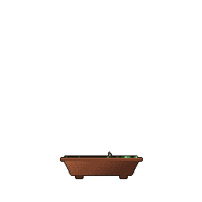

![s_ray9: systems developer, game developer.][banner]

# s_ray9

[![personal-portfolio-badge]][personal-portfolio]

I'm a systems and game developer who builds whatever looks interesting, whether that's games, tools, or something else entirely. Currently, I'm a high school student working on open-source projects and preparing to study engineering.

> **Fun fact:** I've had my GitHub account since 2020.

## Contacts

[![linkedin-badge]][linkedin]
[![youtube-badge]][youtube]
[![discord-badge]][discord]
[![roblox-badge]][roblox]

## Tech stack

## Metrics

<table width="100%">
  <tr align="center">
    <td width="50%">
      
    </td>
    <td width="50%">
      
    </td>
  </tr>
  <tr align="center">
    <td width="50%">
      
    </td>
    <td width="50%">
      
    </td>
  </tr>
</table>

<picture>
  <source media="(prefers-color-scheme: dark)" srcset="https://raw.githubusercontent.com/s-ray9/s-ray9/output/github-contribution-grid-snake-dark.svg">
  
</picture>

[banner]: assets/banner.png

[personal-portfolio]: https://s-ray9.vercel.app

[linkedin]: https://www.linkedin.com/in/sinray-yang
[youtube]: https://youtube.com/@s_ray9
[discord]: https://discord.com/users/627285114875019264
[roblox]: https://www.roblox.com/users/502552415

[personal-portfolio-badge]: https://img.shields.io/badge/Vercel-Personal_Portfolio-white?logo=vercel&logoColor=white&labelColor=black
[linkedin-badge]: https://img.shields.io/badge/LinkedIn-0a66c2
[youtube-badge]: https://img.shields.io/badge/YouTube-ff0000?logo=youtube&logoColor=white
[discord-badge]: https://img.shields.io/badge/Discord-5865f2?logo=discord&logoColor=white
[roblox-badge]:  https://img.shields.io/badge/Roblox-3058f8?logo=roblox&logoColor=white
